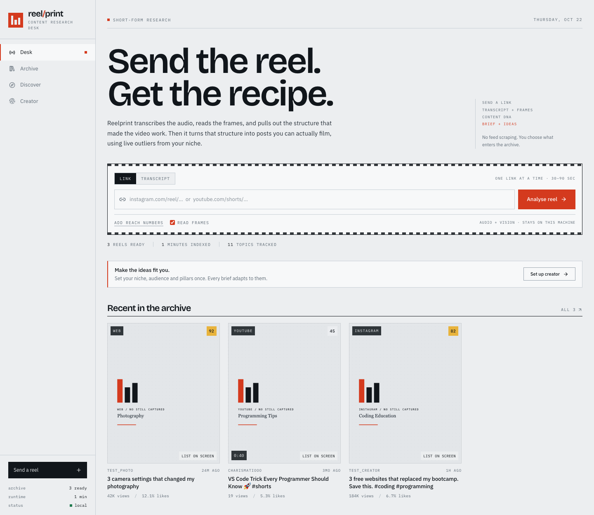
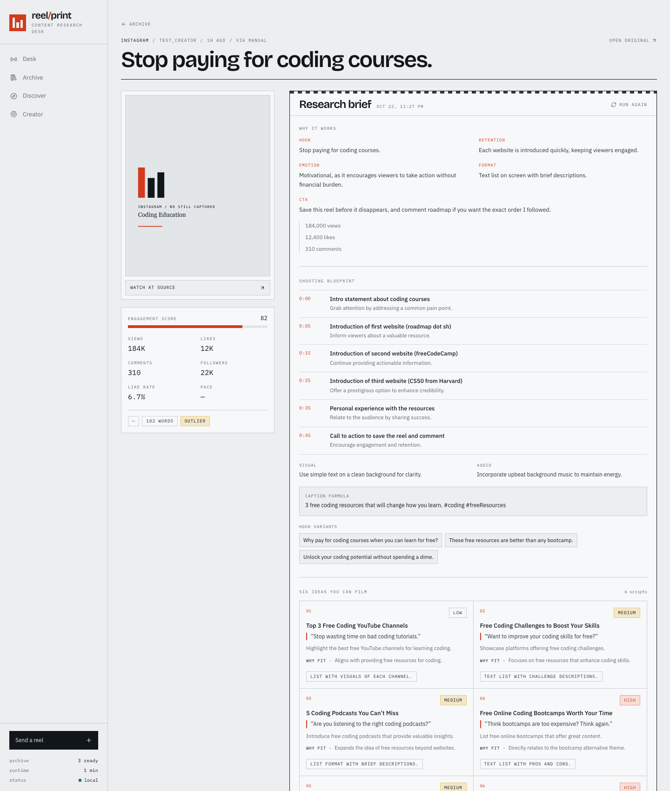
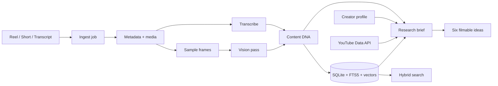

<div align="center">

# Reelprint

**A content research desk for short-form video.**

Send a Reel, Short, or transcript. Reelprint extracts the content DNA, indexes it locally, and turns the mechanics into scripts you can film.

[](https://nextjs.org)
[](https://react.dev)
[](https://www.typescriptlang.org)
[](https://tailwindcss.com)

[](https://ai-sdk.dev)
[](https://openrouter.ai)
[](https://nodejs.org)
[](https://sqlite.org)
[](LICENSE)

[](https://github.com/subhraneel2005/Reelprint/stargazers)
[](https://github.com/subhraneel2005/Reelprint/commits/main)
[](https://github.com/subhraneel2005/Reelprint)

</div>

---

## Overview

Reelprint is a local-first research workspace for people who publish short-form video. Instead of saving reels into a black hole, you send one to the desk and get back a structured breakdown of why it works, what to borrow, and what to film next.

It is built around one constraint: **no feed scraping**. Every video in the archive is there because a person chose to send it.

### What you get

- **Content DNA** for any Reel, Short, or pasted transcript: topic, hook, hook type, format, pacing, structure, CTA, audience, emotion, visual style, keywords, and reusability.
- **A research brief** that reverse-engineers the source and turns it into a shooting blueprint, caption formula, hook variants, and six filmable ideas.
- **A searchable archive** that combines SQLite FTS5 keyword search with vector retrieval and an optional LLM rerank.
- **Live outlier discovery** for YouTube Shorts, ranked by views per hour, like rate, and recency rather than raw vanity counts.
- **A creator profile** that grounds every idea in your niche, audience, pillars, voice, and current goal.

## Preview

<p align="center">
  
</p>

<p align="center">
  
</p>

## Features

| Area | What it does |
| --- | --- |
| Ingest | Accepts Instagram Reels, YouTube Shorts, or a pasted transcript. Handles blocked links without failing silently. |
| Media | Downloads with `yt-dlp`, extracts audio with `ffmpeg`, captures posters, and samples frames for vision. |
| Transcription | Uses Whisper through OpenAI or OpenRouter, Gemini audio, Supadata, or a pasted transcript. |
| Vision | Reads sampled frames with a multimodal model when a vision provider is configured. |
| DNA extraction | Produces typed, validated output with Zod instead of free-form text. |
| Search | Fuses keyword and vector ranks with reciprocal rank fusion, then optionally reranks with an LLM. |
| Discovery | Finds live YouTube Shorts for a topic and scores them by velocity, engagement, and recency. |
| Research | Generates a structured brief, six ideas, next actions, and follow-up search queries. |
| Resilience | Falls back to heuristic DNA, local hash embeddings, captions, and manual transcript entry. |

## Architecture



The pipeline is a persisted job with per-step status. If a stage fails, the UI shows which stage failed and what to do next; a pasted transcript can resume analysis without re-downloading anything.

## Tech stack

| Layer | Choice |
| --- | --- |
| Framework | Next.js 16 App Router, React 19 |
| Language | TypeScript 5 |
| Styling | Tailwind CSS v4 |
| AI | Vercel AI SDK v7 with OpenRouter, OpenAI, and Google Gemini providers |
| Storage | `node:sqlite` with FTS5, local vector embeddings |
| Media | `yt-dlp`, `ffmpeg` |
| Validation | Zod |
| UI | Custom design system, Lucide icons |

## Getting started

### Prerequisites

- Node.js 22 or newer (developed on Node 26)
- `npm`
- `ffmpeg` and `yt-dlp` on your `PATH`

```bash
# macOS
brew install ffmpeg yt-dlp
```

### Install

```bash
git clone https://github.com/subhraneel2005/Reelprint.git
cd Reelprint
npm install
cp .env.example .env.local
```

### Configure

Set at least one model provider in `.env.local`:

```bash
OPENROUTER_API_KEY=sk-or-...
# or
OPENAI_API_KEY=sk-...
# or
GEMINI_API_KEY=...
```

OpenRouter alone can cover chat, structured output, vision, embeddings, and audio transcription. Add `YOUTUBE_API_KEY` to enable live discovery and `SUPADATA_API_KEY` for Instagram transcript and metadata fallback.

### Run

```bash
npm run dev
```

Open [http://localhost:3000](http://localhost:3000). The archive, media, and jobs are stored locally under `.data/`, which is gitignored.

### Scripts

| Command | Description |
| --- | --- |
| `npm run dev` | Start the development server |
| `npm run build` | Create a production build |
| `npm run start` | Serve the production build |
| `npm run lint` | Run ESLint |

## Environment variables

| Variable | Required | Purpose |
| --- | --- | --- |
| `OPENROUTER_API_KEY` | One provider | Chat, vision, embeddings, and Whisper audio |
| `OPENAI_API_KEY` | One provider | Chat, vision, embeddings, and Whisper audio |
| `GEMINI_API_KEY` | One provider | Chat, audio, and vision fallback |
| `AI_PROVIDER` | No | Preferred chat/vision provider: `openrouter`, `openai`, or `gemini` |
| `OPENROUTER_MODEL` | No | Defaults to `openai/gpt-4o-mini` |
| `OPENROUTER_EMBED_MODEL` | No | Defaults to `openai/text-embedding-3-small` |
| `OPENROUTER_TRANSCRIBE_MODEL` | No | Defaults to `openai/whisper-1` |
| `OPENAI_MODEL` | No | Defaults to `gpt-4o-mini` |
| `OPENAI_EMBED_MODEL` | No | Defaults to `text-embedding-3-small` |
| `OPENAI_TRANSCRIBE_MODEL` | No | Defaults to `whisper-1` |
| `GEMINI_MODEL` | No | Defaults to `gemini-flash-latest` |
| `YOUTUBE_API_KEY` | No | Live YouTube Shorts discovery |
| `SUPADATA_API_KEY` | No | Instagram transcript and metadata |
| `IG_COOKIES_FROM_BROWSER` | No | Browser profile for Instagram cookies |
| `IG_COOKIES_FILE` | No | Netscape cookie file for Instagram |
| `YTDLP_COOKIES_FROM_BROWSER` | No | Browser profile for YouTube cookies |
| `YTDLP_COOKIES_FILE` | No | Netscape cookie file for YouTube |
| `APP_URL` | No | OpenRouter attribution and absolute links |

> Audio transcription through OpenRouter may require a minimum account balance. If it is unavailable, Reelprint falls back to captions or a pasted transcript.

## API

| Method | Route | Description |
| --- | --- | --- |
| `POST` | `/api/ingest` | Start an ingest job from a link or transcript |
| `GET` | `/api/jobs/[id]` | Read job status and per-step progress |
| `GET` | `/api/reels` | List the archive |
| `GET` | `/api/reels/[id]` | Read one reel with DNA and research |
| `DELETE` | `/api/reels/[id]` | Remove a reel from the archive |
| `POST` | `/api/reels/[id]/transcript` | Resume a blocked reel with a transcript |
| `POST` | `/api/reels/[id]/retry` | Re-run DNA extraction and indexing |
| `GET` | `/api/search` | Hybrid search with optional reranking |
| `GET` | `/api/research` | Read a cached research brief |
| `POST` | `/api/research` | Generate or refresh a research brief |
| `GET` | `/api/profile` | Read the creator profile and provider status |
| `POST` | `/api/profile` | Save the creator profile |
| `GET` | `/api/youtube` | Discover live YouTube Shorts for a query |
| `GET` | `/api/thumb/[id]` | Serve a poster or generated placeholder |

## Project structure

```text
.
├── docs/                  README screenshots
├── public/                App icon and static assets
├── src/
│   ├── app/               App Router pages, API routes, manifest, share target
│   ├── components/        Ingest, archive, research, discovery, profile UI
│   └── lib/
│       ├── ai.ts          AI SDK providers, structured output, vision, embeddings
│       ├── db.ts          SQLite schema, FTS5, CRUD, profile, research cache
│       ├── ingest.ts      Job pipeline, transcription, scoring, indexing
│       ├── media.ts       yt-dlp, ffmpeg, posters, frame sampling
│       ├── prompts.ts     DNA and research prompts, Zod schemas, heuristics
│       ├── research.ts    Reverse-engineering brief and idea generation
│       ├── search.ts      Hybrid retrieval and reranking
│       └── youtube.ts     Live Shorts discovery and outlier scoring
├── .env.example
├── next.config.ts
└── package.json
```

## Design decisions

- **Local-first by default.** Transcripts, embeddings, jobs, and the creator profile live in `.data/`. There is no account and no hosted database.
- **Provider-agnostic AI.** The Vercel AI SDK lets the same pipeline run on OpenRouter, OpenAI, or Gemini without rewriting prompts or parsing.
- **Structured output over string parsing.** DNA and research briefs are validated with Zod, with a heuristic fallback when a model is unavailable.
- **Honest failure states.** A blocked Instagram fetch, missing transcript, or unavailable vision model is surfaced in the job timeline instead of producing a fake result.
- **No seeded archive.** Every entry came from an explicit user action.

## Limitations

- Instagram is login-walled for logged-out fetches. Use Supadata, a local cookie session, or paste the transcript.
- Instagram has no public discovery API. Discover is YouTube-only and labelled as such in the UI.
- YouTube may occasionally require cookies or reject automated downloads; the job reports the exact error.
- The archive is single-user and local. Running multiple instances against the same `.data/` directory is not supported.
- Search quality depends on the embedding provider. Without one, Reelprint uses a local hash embedding as a graceful fallback.

## Roadmap

- [x] Link and transcript ingest with resumable jobs
- [x] Content DNA, hybrid search, and research briefs
- [x] OpenRouter, OpenAI, and Gemini through the Vercel AI SDK
- [x] YouTube Shorts outlier discovery
- [ ] Meta-approved Instagram connector
- [ ] Scheduled discovery and alerts
- [ ] Profile-vs-outlier comparison scoring
- [ ] Export scripts to Notion, Google Docs, or Markdown
- [ ] Optional multi-user workspace

## Contributing

Issues and pull requests are welcome. Please keep changes scoped, run `npm run lint` and `npm run build` before opening a PR, and never commit `.env.local` or anything under `.data/`.

## Acknowledgements

Built on [Next.js](https://nextjs.org), [Vercel AI SDK](https://ai-sdk.dev), [OpenRouter](https://openrouter.ai), [OpenAI](https://openai.com), [Google Gemini](https://ai.google.dev), [yt-dlp](https://github.com/yt-dlp/yt-dlp), and [FFmpeg](https://ffmpeg.org).

## License

Released under the [MIT License](LICENSE).
