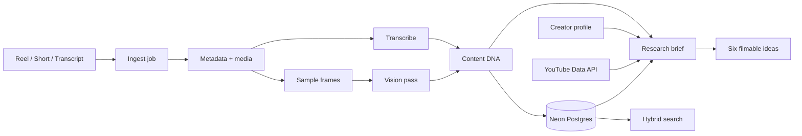

# Reelprint

**A content research desk for short-form video.**

Send a Reel, Short, or transcript. Reelprint extracts the content DNA, indexes it in Postgres, and turns the mechanics into scripts you can film.

[](https://nextjs.org)
[](https://react.dev)
[](https://www.typescriptlang.org)
[](https://neon.tech)
[](https://orm.drizzle.team)

## Quick start

Requires Node.js 24+, `ffmpeg`, `ffprobe`, `yt-dlp`, and a Postgres database (Neon works well).

```bash
git clone https://github.com/subhraneel2005/Reelprint.git
cd Reelprint
npm install
cp .env.example .env.local
```

Add at least `DATABASE_URL` and `OPENROUTER_API_KEY` to `.env.local`, then apply the schema:

```bash
npm run db:migrate
npm run dev
```

Open [http://localhost:3000](http://localhost:3000).

Pasted transcripts work without FFmpeg or yt-dlp. Link ingestion needs both.

```bash
# macOS
brew install ffmpeg yt-dlp

# Ubuntu / Debian
sudo apt-get update && sudo apt-get install -y ffmpeg yt-dlp
```

### Bring over the old SQLite archive

The SQLite database is no longer used at runtime. To import it once:

```bash
# DATABASE_URL must point at the target Postgres database
npm run db:seed
```

The importer reads `.data/reelprint.db`, updates matching rows, and leaves the file untouched. Keep a backup before running it against production.

## What it does

- **Content DNA** for a Reel, Short, or pasted transcript: topic, hook, format, pacing, structure, CTA, audience, emotion, visual style, keywords, and reusability.
- **Research brief** that reverse-engineers the source into a shooting blueprint, caption formula, hook variants, and six filmable ideas.
- **Searchable archive** using Postgres full-text search plus local vector ranking.
- **Live outlier discovery** for YouTube Shorts, ranked by pace, like rate, and recency.
- **Creator profile** that grounds every idea in your niche, audience, pillars, voice, and current goal.

The app never scrapes a feed. Every entry in the archive was chosen by a person.

## Architecture



Jobs are persisted with per-step status. If a stage fails, the UI shows what happened and lets a pasted transcript resume the analysis without re-downloading the media.

## Tech stack

| Layer | Choice |
| --- | --- |
| Framework | Next.js 16 App Router, React 19 |
| Language | TypeScript 5 |
| Styling | Tailwind CSS v4, shadcn/ui |
| AI | Vercel AI SDK v7 with OpenRouter, OpenAI, and Google Gemini providers |
| Database | Neon Postgres, Drizzle ORM |
| Search | Postgres full-text search + cosine similarity over `real[]` embeddings |
| Media | `yt-dlp`, `ffmpeg`, local persistent volume |
| Validation | Zod |
| Packaging | Multi-stage Docker image, Next.js standalone output |

## Environment

Copy `.env.example` to `.env.local` for local development. For Docker Compose, pass the same file with `--env-file`.

| Variable | Required | Purpose |
| --- | --- | --- |
| `DATABASE_URL` | **Yes** | Neon/Postgres connection string |
| `OPENROUTER_API_KEY` | **Yes, for AI** | Chat, vision, embeddings, and Whisper audio |
| `OPENAI_API_KEY` | No | Optional provider fallback |
| `GEMINI_API_KEY` | No | Optional provider fallback |
| `AI_PROVIDER` | No | Preferred provider: `openrouter`, `openai`, or `gemini` |
| `YOUTUBE_API_KEY` | No | Live YouTube Shorts discovery |
| `SUPADATA_API_KEY` | No | Instagram transcript and metadata |
| `IG_COOKIES_FROM_BROWSER` | No | Local Instagram session for yt-dlp |
| `IG_COOKIES_FILE` | No | Exported Instagram cookie file |
| `YTDLP_COOKIES_FROM_BROWSER` | No | Local YouTube session for yt-dlp |
| `YTDLP_COOKIES_FILE` | No | Exported YouTube cookie file |
| `APP_URL` | No | Public base URL for attribution and absolute links |

OpenRouter requires at least **$0.50** of account balance for audio transcription. Without it, Reelprint falls back to captions or a pasted transcript.

## Scripts

| Command | Description |
| --- | --- |
| `npm run dev` | Start the development server |
| `npm run build` | Create a production build |
| `npm run start` | Serve the production build |
| `npm run lint` | Run ESLint |
| `npm run typecheck` | Run TypeScript without emitting files |
| `npm run check` | Lint, typecheck, and production build |
| `npm run db:generate` | Generate a Drizzle migration from schema changes |
| `npm run db:migrate` | Apply pending migrations to `DATABASE_URL` |
| `npm run db:seed` | Import the legacy SQLite archive |

## Docker

The image includes Node.js, FFmpeg, FFprobe, and yt-dlp. It runs as a non-root user and writes media to `/app/.data`.

Apply migrations **before** starting a new image against a fresh database:

```bash
# from the repository, with DATABASE_URL set
npm run db:migrate

docker build -t reelprint:local .
docker run --rm -p 3000:3000 \
  --env-file .env.local \
  -v reelprint-data:/app/.data \
  reelprint:local
```

Or with Compose:

```bash
npm run db:migrate
docker compose --env-file .env.local up --build
```

Useful container commands:

```bash
docker compose logs -f
docker compose down
docker compose build --no-cache
```

## Deploying

Reelprint is a long-running Node.js app with media on disk and jobs running in-process.

1. Create a Neon database and set `DATABASE_URL`.
2. Run `npm run db:migrate` with the production `DATABASE_URL`.
3. Build and deploy the Docker image.
4. Mount a persistent volume at `/app/.data` for posters, frames, and temporary media.
5. Set `APP_URL` to the public URL and expose port `3000`.
6. Run **one replica**, because ingest jobs are in-process.

Good targets: Fly.io, Railway, Render, a Docker host, or a small VPS. **Vercel/serverless is not a fit** for the media pipeline and in-process jobs.

> **Security:** there are no accounts or built-in authentication. Anyone with the URL can spend AI credits and edit the archive. Put the deployment behind Cloudflare Access, a VPN, basic auth, or another auth proxy. Never commit `.env.local` or API keys.

## Project structure

```text
.
├── drizzle/                  Generated Postgres migrations
├── scripts/
│   ├── clean-standalone.mjs  Build helper
│   └── migrate-sqlite.ts     One-time SQLite importer
├── src/
│   ├── app/                  Pages, API routes, manifest, share target
│   ├── components/           Ingest, archive, research, discovery, profile UI
│   └── lib/
│       ├── ai.ts             AI providers, structured output, vision, embeddings
│       ├── db.ts             Postgres CRUD, profile, search, research cache
│       ├── postgres.ts       Pooled Drizzle client
│       ├── schema.ts         Drizzle table definitions
│       ├── ingest.ts         Job pipeline and indexing
│       ├── media.ts          yt-dlp, ffmpeg, posters, frame sampling
│       ├── prompts.ts        DNA/research prompts, schemas, heuristics
│       ├── research.ts       Brief and idea generation
│       ├── search.ts         Postgres FTS + vector retrieval
│       └── youtube.ts        Live Shorts discovery
├── Dockerfile
├── docker-compose.yml
├── drizzle.config.ts
└── package.json
```

## Data

- **Postgres** stores reels, jobs, research, the profile, and embeddings. Use Neon branches or point-in-time restore for backups.
- **`.data/media/`** stores posters and captured frames. Back up the Docker volume if those files matter.
- **`.data/tmp/`** is disposable working space.
- The old `.data/reelprint.db` is only an import source now.
- Never commit `.data/`, `.env`, or `.env.local`.

## Limitations

- Instagram is login-walled for logged-out fetches. Use Supadata, a local cookie session, or paste the transcript.
- Instagram has no public discovery API. Discover is YouTube-only.
- YouTube may occasionally require cookies or reject automated downloads; the job reports the exact error.
- The archive is single-user. There is no authentication or multi-tenant isolation yet.
- Media is not replicated across instances. Use one replica with a persistent volume.
- Without an embedding provider, Reelprint falls back to a local hash embedding.

## Contributing

Issues and pull requests are welcome. Run `npm run check` before opening a PR, and never commit `.env.local` or anything under `.data/`.

## License

Released under the [MIT License](LICENSE).
